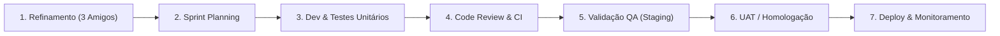
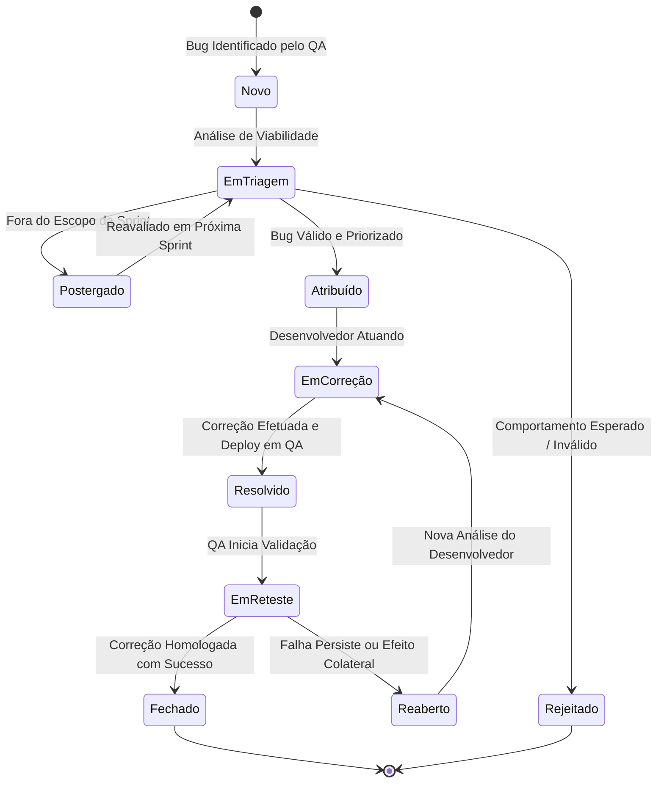

# Plano de Fluxo de Trabalho de Desenvolvimento e Ciclo de Vida do Bug

> **Projeto:** OficinaTech Pro – Sistema Integrado de Gestão para Oficinas Mecânicas  
> **Módulo:** Gerenciamento de Ordens de Serviço (O.S.)  
> **Disciplina:** Engenharia e Qualidade de Software (QA)  
> **Versão da Documentação:** 1.0  
> **Autor:** Equipe de Qualidade e Testes de Software  

---

## 1. Visão Geral do Sistema e Módulo de O.S.

O **OficinaTech Pro** é uma aplicação corporativa concebida para modernizar a operação de oficinas mecânicas automotivas de médio e grande porte. A aplicação centraliza desde o agendamento inicial e check-in do veículo até o diagnóstico veicular, orçamento discriminado de peças e mão de obra, aprovação digital pelo cliente, execução do reparo e emissão de notas fiscais com histórico veicular.

O **Módulo de Ordem de Serviço (O.S.)** representa o coração operacional da oficina, garantindo que nenhum serviço seja executado sem rastreabilidade, controle de custos, autorização do proprietário e validação de qualidade pré-entrega.

---

## 2. Plano de Fluxo de Trabalho de Desenvolvimento (SDLC & Shift-Left QA)

Para assegurar lançamentos previsíveis, seguros e com baixo índice de defeitos em produção, o ciclo de desenvolvimento adota uma abordagem ágil com **Shift-Left Testing**, na qual o controle de qualidade atua ativamente desde a concepção dos requisitos até a operação em produção.

### 2.1. Macrofluxo das Etapas de Desenvolvimento



---

### 2.2. Detalhamento das Etapas e Atuação do QA

#### Etapa 1: Refinamento de Requisitos (Three Amigos / Refinement)
* **Participantes:** Product Owner (PO), Desenvolvedor (Dev) e Engenheiro de QA.
* **Atividades:**
  - Análise crítica das User Stories voltadas para o Módulo de O.S.
  - Identificação prévia de ambiguidades, regras de negócio não mapeadas e cenários de exceção (ex.: divergência de hodômetro, placas Mercosul vs. antigas).
  - Elaboração dos Critérios de Aceite preliminares em formato BDD.
  - Garantia do **DoR (Definition of Ready)** antes que o item entre na Sprint.
* **Papel do QA:** Questionador de riscos, levantamento de cenários limítrofes (edge cases) e garantia de testabilidade dos requisitos.

#### Etapa 2: Planejamento da Sprint (Sprint Planning)
* **Atividades:** Quebra de tarefas técnicas e planejamento da estratégia de teste.
* **Papel do QA:** Estimar esforço de testes manuais e automatizados, mapear massas de teste necessárias (veículos, clientes, peças) e estruturar o plano de cobertura da sprint.

#### Etapa 3: Desenvolvimento e Testes de Baixo Nível
* **Atividades:**
  - Desenvolvimento da funcionalidade em branches de feature (`feature/OS-xxx`).
  - Criação de testes unitários e de integração pela equipe de desenvolvimento.
* **Papel do QA:** Apoio consultivo ao time de desenvolvimento sobre regras de negócio e acompanhamento da cobertura de testes unitários (meta mínima: 80%).

#### Etapa 4: Code Review e Pipeline de Integração Contínua (CI)
* **Atividades:**
  - Pull Request (PR) avaliado por ao menos 1 revisor sênior.
  - Execução automática de linters, testes unitários e análise estática de código (SonarQube) no GitHub Actions.
  - Quality Gate: Bloqueio de merge em caso de quebra de testes ou falha de vulnerabilidade/code smells críticos.

#### Etapa 5: Validação em Ambiente de QA / Staging
* **Atividades:**
  - Deploy automatizado da branch integrada no ambiente de homologação técnica (Staging/QA).
  - Execução dos casos de teste manuais (Step-by-step e exploratórios baseados em risco).
  - Execução da suíte de regressão automatizada (API e E2E).
  - Aferição dos critérios de aceite da User Story.
* **Papel do QA:** Responsável direto pela homologação da entrega, aprovação funcional ou reporte de impedimentos.

#### Etapa 6: Homologação pelo Usuário (UAT) e Validação de Negócio
* **Atividades:**
  - Validação de fluxo ponta a ponta com o Product Owner e consultores mecânicos piloto.
  - Verificação do cumprimento da **Definition of Done (DoD)**.

#### Etapa 7: Deploy em Produção (CD) e Monitoramento
* **Atividades:**
  - Release em produção via pipeline seguro.
  - Execução de Smoke Tests (testes de fumaça) pós-deploy em produção.
  - Monitoramento contínuo de logs (Sentry/Datadog) e telemetria da aplicação.

---

### 2.3. Critérios de Qualidade: DoR e DoD

| Critério | Descrição para o Módulo de Ordem de Serviço |
|---|---|
| **Definition of Ready (DoR)** | A User Story possui: objetivo claro de negócio; critérios de aceite escritos em BDD; regras de negócio de oficina detalhadas; protótipos de tela aprovados; dependências externas mapeadas; estimativa validada pelo time; aprovada pelo QA nos Three Amigos. |
| **Definition of Done (DoD)** | O código foi revisado por pares; testes unitários passando com cobertura $\ge 80\%$; testes de integração e regressão executados sem falhas; critérios de aceite validados pelo QA em Staging; documentação técnica e de testes atualizada; sem bugs abertos de severidade Crítica ou Alta. |

---

## 3. Ciclo de Vida do Bug (Defect Life Cycle)

O Ciclo de Vida do Bug estabelece o fluxo padronizado que qualquer anomalia identificada no sistema percorre, desde sua descoberta até sua resolução definitiva e arquivamento.

### 3.1. Diagrama de Transição de Estados do Bug



---

### 3.2. Descrição Detalhada dos Estados

1. **Novo (New):**
   - O defeito é registrado na ferramenta de rastreamento (Jira/GitHub Issues) com template completo de reporte pelo QA ou usuário.
2. **Em Triagem (Triaged / Under Review):**
   - O QA Lead, Tech Lead e PO analisam o bug para validar: autenticidade, duplicidade, impacto no negócio e classificação correta de Severidade e Prioridade.
3. **Rejeitado (Rejected / Won't Fix):**
   - O comportamento relatado não é um erro de software, mas sim uma regra de negócio legítima, má interpretação de especificação ou limitação documentada. Requer justificativa clara.
4. **Postergado (Deferred):**
   - Bug reconhecido, porém seu impacto é cosmético/baixo ou sua correção depende de refatoração programada para sprints futuras.
5. **Atribuído (Assigned):**
   - O bug é direcionado ao desenvolvedor ou esquadra responsável pelo módulo afetado (ex.: equipe de Core/Ordens de Serviço).
6. **Em Correção (In Progress / Fixing):**
   - O desenvolvedor reproduz a falha, isola a causa raiz no código/banco de dados e desenvolve a solução com testes de regressão unitários.
7. **Resolvido (Resolved / Ready for Test):**
   - A correção foi comitada, aprovada em Code Review e implantada no ambiente de QA/Staging, pronta para verificação.
8. **Em Reteste (Retesting):**
   - O QA executa novamente os passos exatos de reprodução no mesmo ambiente em que a falha foi originalmente detectada, além de testes regressivos nas telas adjacentes.
9. **Reaberto (Reopened):**
   - Se o defeito persistir total ou parcialmente, ou se a correção tiver quebrado outro componente correlato, o bug retorna para o desenvolvedor com novos logs e evidências.
10. **Fechado (Closed):**
    - Aprovado no reteste. O QA anexa o parecer de sucesso com evidência e encerra formalmente o ciclo do ticket.

---

### 3.3. Matriz de Classificação: Severidade vs. Prioridade

A severidade reflete o **impacto técnico/operacional no sistema**, enquanto a prioridade reflete a **urgência de negócio para a entrega da solução**.

#### Classificação de Severidade (Impacto Técnico)
* **Crítica (Blocker):** O sistema fica inoperante; perda irreversível de dados; impossibilidade completa de emitir ou faturar O.S.; crash da aplicação sem contorno.
* **Alta (Major):** Funcionalidade essencial com falha grave, porém com contorno difícil ou paliativo (ex.: cálculo incorreto de impostos ou peças não somadas no totalizador).
* **Média (Moderate):** Falha em funcionalidade secundária (ex.: filtro de busca por placa falha em caracteres minúsculos; comprovante gera quebra de página incorreta).
* **Baixa (Minor):** Problemas cosméticos, erros ortográficos, desalinhamento de botões ou inconsistência puramente visual que não prejudica a operação.

#### Classificação de Prioridade (Urgência de Negócio)
* **P1 (Imediata):** Correção em caráter de emergência (*hotfix* imediato), bloqueando entregas ou produção.
* **P2 (Alta):** Deve ser corrigido na sprint corrente antes da liberação da versão.
* **P3 (Média):** Agendado no fluxo normal de backlog da próxima sprint.
* **P4 (Baixa):** Correção quando houver oportunidade de melhoria técnica ou visual.

---

### 3.4. Padrão de Reporte de Bugs (Template Corporativo com Exemplo Real)

Abaixo é apresentado o modelo formal de reporte adotado pela equipe de QA, preenchido com um cenário real no módulo de O.S.:

```markdown
================================================================================
RELATÓRIO DE DEFEITO (BUG REPORT) - OFICINATECH PRO
================================================================================
ID: BUG-OS-1042
TÍTULO: Valor total da O.S. não recalcula após remoção de item de peça no orçamento
MÓDULO: Gestão de Ordens de Serviço / Orçamento e Peças
AMBIENTE: Staging / QA (Versão 2.4.1-rc3)
NAVEGADOR / SO: Google Chrome v128.0.x / Windows 11 Pro 64-bit
SEVERIDADE: Alta (Major)
PRIORIDADE: P2 (Alta)
AUTOR: Engenheiro de QA
ATRIBUÍDO A: Equipe Back-end / Front-end Core

1. PRÉ-CONDIÇÕES:
- Usuário logado com perfil "Consultor Técnico" ou "Mecânico Líder".
- Ordem de Serviço com status "Em Diagnóstico / Orçamento em Elaboração".
- O.S. contendo ao menos 2 peças adicionadas (Ex.: 1x Filtro de Óleo R$ 60,00 e 4x Óleo 5W30 R$ 200,00 - Subtotal: R$ 260,00).

2. PASSOS PARA REPRODUÇÃO:
1. Acessar o menu "Ordens de Serviço" > "Consultar O.S.".
2. Abrir a O.S. nº OS-2026-00412.
3. Navegar até a aba "Peças & Materiais".
4. Na linha do item "Filtro de Óleo (R$ 60,00)", clicar no ícone de lixeira ("Excluir Item").
5. Confirmar a exclusão no modal de confirmação.
6. Observar o grid de itens e o card de "Resumo Financeiro da O.S.".

3. RESULTADO OBTIDO:
O item "Filtro de Óleo" desaparece visualmente da tabela de peças, mas o valor do
"Subtotal de Peças" e o "Valor Total Geral da O.S." permanecem inalterados em R$ 260,00.
Ao salvar a O.S., a requisição POST envia o valor residual defasado, gerando
cobrança indevida ao cliente.

4. RESULTADO ESPERADO:
Após a remoção do item, o sistema deve disparar o evento de recálculo imediato:
- Subtotal de Peças deve atualizar automaticamente para R$ 200,00.
- Valor Total da O.S. deve ser atualizado refletindo o abatimento dos R$ 60,00.
- O payload gravado no banco de dados deve refletir estritamente os itens presentes.

5. EVIDÊNCIAS & LOGS:
- Anexo: print_tela_inconsistencia_totais.png
- Console Log: "Uncaught TypeError: updateFinancialSummary is not a function at deleteRow.js:42"
- Network Payload: {"os_id": 412, "subtotal_pecas": 260.00, "itens_count": 1}

6. DADOS DE TESTE UTILIZADOS:
- Veículo: Honda Civic 2021 (Placa: BRA2E19)
- O.S. de Teste: #OS-2026-00412
================================================================================
```
