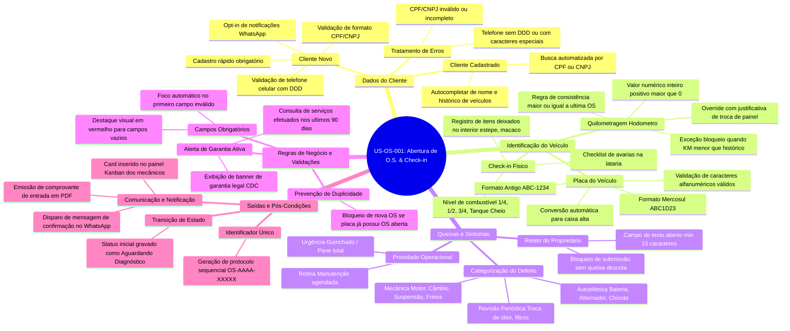

# Documentação de Testes: Mind-Map da User Story (US-OS-001)

> **Projeto:** OficinaTech Pro – Sistema Integrado de Gestão para Oficinas Mecânicas  
> **Módulo:** Gerenciamento de Ordens de Serviço (O.S.)  
> **História Mapeada:** `US-OS-001` – Abertura de Nova O.S. com Check-in Técnico e Validação Cadastral  
> **Técnica de QA:** Mapeamento Mental e Exploração Visual de Cenários de Teste  
> **Versão:** 1.0  

---

## 1. Objetivo do Mapa Mental no Processo de QA

O Mapa Mental (Mind-Map) é uma técnica fundamental utilizada pela Engenharia de Qualidade durante a fase de **Shift-Left Testing** para dissecar a história de usuário, quebrando-a visualmente em dimensões funcionais, regras de negócio, dados de entrada, caminhos felizes, fluxos de exceção, segurança e integrações.

Essa técnica permite ao QA:
- Obter **100% de cobertura conceitual** dos cenários antes do início do desenvolvimento.
- Identificar dependências e riscos técnicos ocultos (ex.: inconsistência de hodômetro).
- Servir como base direta para a elaboração dos Casos de Teste Step-by-Step e BDD.

---

## 2. Diagrama de Mapa Mental (Mermaid)

---

## 3. Matriz de Cobertura Derivada do Mapa Mental

A partir das ramificações do Mapa Mental, a equipe de QA derivou as seguintes frentes de teste:

| Ramificação do Mapa | Tipo de Teste Aplicado | Objetivos e Cenários Cobertos |
|---|---|---|
| **1. Dados do Cliente** | Funcional / Validação de Dados | Testar busca por CPF, autocompletar de dados, cadastro de novo cliente, máscara de telefone e rejeição de CPFs inválidos. |
| **2. Identificação do Veículo** | Regra de Negócio / Limite | Testar formatos de placa (Mercosul e Antiga), validação de hodômetro vs. histórico da oficina e consistência do checklist. |
| **3. Queixas e Sintomas** | Interface / Usabilidade | Validar tamanho mínimo do relato, seleção de categorias automotivas e preenchimento de checklist de avarias. |
| **4. Validações Críticas** | Negativo / Segurança | Tentar cadastrar O.S. duplicada para veículo já presente na oficina; validar disparo de alerta de garantia legal de 90 dias. |
| **5. Saídas e Integrações** | Integração / E2E | Validar geração do número sequencial `OS-2026-XXXXX`, gravação do status inicial e envio de evento para Kanban e WhatsApp. |

---

## 4. Árvore de Ideias de Teste (Test Idea Tree)

* **Eixo 1: Caminho Feliz (Happy Paths)**
  - [x] Abertura com cliente existente + placa Mercosul + KM consistente + geração de O.S.
  - [x] Abertura com cliente novo cadastrado na hora + placa padrão antigo + relato preenchido.
  - [x] Envio de notificação no WhatsApp com link de acompanhamento do status.
* **Eixo 2: Cenários Negativos e de Exceção (Negative Testing)**
  - [x] Hodômetro com valor inferior ao da última O.S. finalizada (Bloqueio obrigatório).
  - [x] Placa com caracteres inválidos (ex.: símbolos, espaços ou menos de 7 dígitos).
  - [x] Veículo com O.S. em andamento na oficina (Bloqueio de duplicidade).
  - [x] Submissão com campos obrigatórios vazios.
* **Eixo 3: Regras Legais e de Negócio da Oficina**
  - [x] Identificação de peças/serviços trocados há menos de 90 dias para aplicação de garantia.
  - [x] Registro fotográfico das avarias de lataria para prevenção de litígios no check-in.
